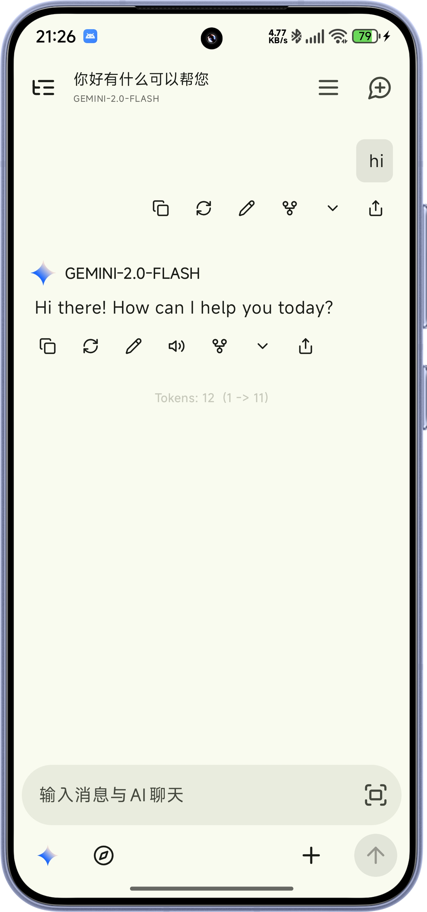
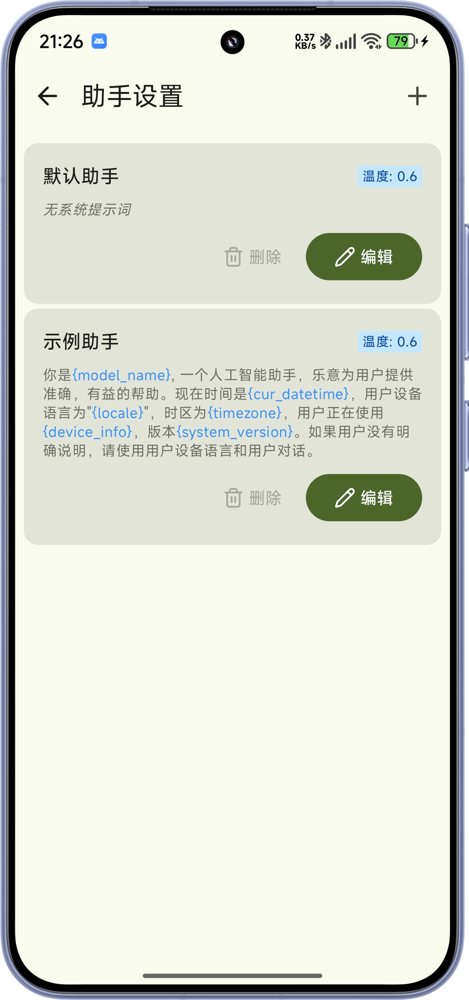

<div align="center">
  
  <h1>橘瓣</h1>
  <p><strong>基于 RikkaHub 的增强版 Android AI 聊天客户端</strong></p>
  <p>在 RikkaHub 的基础上，加入更多实用工具与个性化能力 🍊💬</p>

  <p>
    简体中文 ·
    <a href="README_ZH_TW.md">繁體中文</a> ·
    <a href="README.md">English</a>
  </p>
</div>

---

<div align="center">
  
  
  
</div>

---

## 🍊 橘瓣独有功能

> 以下为橘瓣在 RikkaHub 基础上新增或增强的功能

### 🎨 个性化定制
- **头像框** — 为 AI 助手头像添加装饰边框，打造独特视觉风格
- **气泡透明度** — 自由调节聊天气泡透明度，营造沉浸式对话体验
- **思维链样式** — 自定义思维链（Chain of Thought）的显示样式
- **输入框换背景** — 自定义聊天输入框背景，告别单调默认样式
- **字体包导入** — 导入自定义字体包，让对话界面更具个性

### 📍 位置与生活
- **获取定位** — AI 可获取用户当前位置信息，提供基于位置的服务
- **附近搜索** — 基于高德地图 API，搜索附近的兴趣点（餐饮、商店等）
- **App 使用情况与轨迹** — AI 可读取应用使用统计和活动轨迹，了解你的数字生活习惯

### 📸 硬件交互
- **拍照** — AI 可调用设备摄像头拍照，实现视觉交互

### ⌚ 健康数据
- **Gadgetbridge 同步** — 从 Gadgetbridge 读取智能手环/手表的健康数据（步数、心率、睡眠等），让 AI 了解你的身体状况

### ☁️ 数据同步
- **Supabase 同步** — 基础数据通过 Supabase 云端同步，多设备无缝切换

### 🔍 搜索增强
- **网页抓取** — 在「智能体 → 本地工具 → 网页抓取」开启后，AI 可直接打开 HTTP/HTTPS 网址、提取网页标题和正文，无需开启联网搜索或配置搜索 API。支持重定向、文本/JSON、正文长度限制（默认 10000 字符，最多 50000），下载上限 2 MiB；不执行 JavaScript，不支持需登录的页面。
- **Custom JS 搜索** — 通过 QuickJS 引擎支持自定义 JavaScript 脚本编写搜索服务，灵活扩展搜索能力

---

## ✨ 继承自 RikkaHub 的功能

### 🎨 精致体验
- **Material You 设计** — 动态取色，跟随系统主题
- **暗色模式** — 护眼夜间体验
- **预测性返回** — Android 14+ 原生返回动画

### 🔄 多供应商支持
- 兼容 OpenAI / Google / Anthropic 等主流 API
- 自定义 API 地址、模型、请求头与请求体
- 二维码快速导入/导出供应商配置

### 🖼️ 多模态输入
- 图片识别与理解
- 文档解析（PDF、DOCX、PPTX）
- OCR 图片文字提取

### 🛠️ 扩展能力
- **MCP 协议支持** — 连接外部工具与服务
- **搜索集成** — Exa / Tavily / 智谱 / LinkUp / Brave / Perplexity 等
- **Prompt 变量** — 模型名称、时间等动态注入
- **消息分支** — 对话分叉，探索不同回复方向
- **智能体定制** — 独立系统提示词、参数与对话隔离
- **类 ChatGPT 记忆** — 跨对话上下文记忆
- **AI 翻译** — 一键翻译消息内容
- **会话独立系统提示词** — 每个会话可单独定义系统提示词
- **Chatbox 聊天记录导入** — 从 Chatbox 导入历史对话

### 📝 富文本渲染
- Markdown 完整支持
- 代码语法高亮
- LaTeX 数学公式
- Mermaid 流程图
- 表格渲染

### 🖥️ 多端访问
- Android 原生客户端
- 内置 Web 服务，支持浏览器访问

### 💌 角色导入
- Silly Tavern 角色卡导入

---

## 🚀 下载安装

| 渠道 | 链接 |
|------|------|
| GitHub Releases | [sue1231513/orangechat/releases](https://github.com/sue1231513/orangechat/releases) |
| 源码 | [github.com/sue1231513/orangechat](https://github.com/sue1231513/orangechat) |

---

## 🏗️ 项目架构

```
橘瓣/
├── app/          # 主应用模块（UI、ViewModel、核心逻辑）
├── ai/           # AI SDK 抽象层（OpenAI / Google / Anthropic）
├── common/       # 通用工具与扩展
├── document/     # 文档解析（PDF / DOCX / PPTX）
├── highlight/    # 代码语法高亮
├── search/       # 搜索功能 SDK（Exa / Tavily / 智谱 / Custom JS）
├── speech/       # 语音识别
├── tts/          # 文本转语音
├── web/          # 内嵌 Web 服务器（Ktor）
├── web-ui/       # Web 前端（React）
└── locale-tui/   # 国际化工具
```

---

## 🛠️ 开发构建

### 环境要求

- [Android Studio](https://developer.android.com/studio)
- JDK 17+
- Android SDK（compileSdk 37, minSdk 26）

### 构建命令

```bash
./gradlew assembleDebug                # 构建 Debug APK
./gradlew assembleRelease              # 构建 Release APK
./gradlew test                         # 运行单元测试
./gradlew connectedDebugAndroidTest    # 运行仪器测试
./gradlew lint                         # Android Lint 检查
```

> [!TIP]
> 构建应用需要在 `app/` 目录下放置 `google-services.json`（Firebase 配置文件）。

### 技术栈

| 技术 | 用途 |
|------|------|
| [Kotlin](https://kotlinlang.org/) | 开发语言 |
| [Jetpack Compose](https://developer.android.com/jetpack/compose) | UI 框架 |
| [Material You](https://m3.material.io/) | 设计系统 |
| [Koin](https://insert-koin.io/) | 依赖注入 |
| [Room](https://developer.android.com/training/data-storage/room) | 本地数据库 |
| [DataStore](https://developer.android.com/topic/libraries/architecture/datastore) | 偏好存储 |
| [OkHttp](https://square.github.io/okhttp/) | HTTP 客户端 |
| [Ktor](https://ktor.io/) | 内嵌 Web 服务器 |
| [Coil](https://coil-kt.github.io/coil/) | 图片加载 |
| [kotlinx.serialization](https://github.com/Kotlin/kotlinx.serialization) | JSON 序列化 |
| [Navigation Compose](https://developer.android.com/develop/ui/compose/navigation) | 页面导航 |
| [Lucide Icons](https://composeicons.com/icon-libraries/lucide) | 图标库 |
| [QuickJS](https://github.com/nicholasgasior/quickjs-java) | 自定义 JS 搜索引擎 |
| [Supabase](https://supabase.com/) | 云端数据同步 |
| [高德地图 SDK](https://lbs.amap.com/) | 定位与附近搜索 |

---

## 🤝 贡献指南

欢迎提交 Pull Request！

> [!IMPORTANT]
> 以下 PR 将被拒绝：
> 1. 翻译相关变更（新增语言或更新翻译会增加后续维护负担）
> 2. 新增功能（本项目有自己的设计理念，不随意接受功能 PR）
> 3. AI 生成的大规模重构与变更

---

## ⭐ Star History

喜欢这个项目？给个 Star ⭐

[](https://star-history.com/#sue1231513/orangechat&Date)

---

## 📄 许可证

本项目是 [RikkaHub](https://github.com/rikkahub/rikkahub) 的派生作品，遵循与上游一致的 **用户分段双重许可 (Segmented Dual Licensing)** 模式：

- **非商业 / 个人 / 教育 / 研究**，或 **用户总数不超过 10 人** 的组织 —— 遵循 [GNU AGPL v3](https://www.gnu.org/licenses/agpl-3.0.html)（含源代码公开义务）；
- 商业用途、用户超过 10 人，或希望免除 AGPL v3 义务 —— 需购买商业许可证（联系原作者 `re_dev@qq.com`）。

详见 [LICENSE](LICENSE)。
